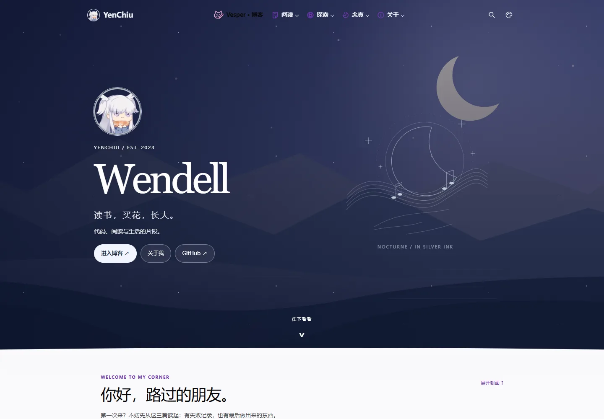
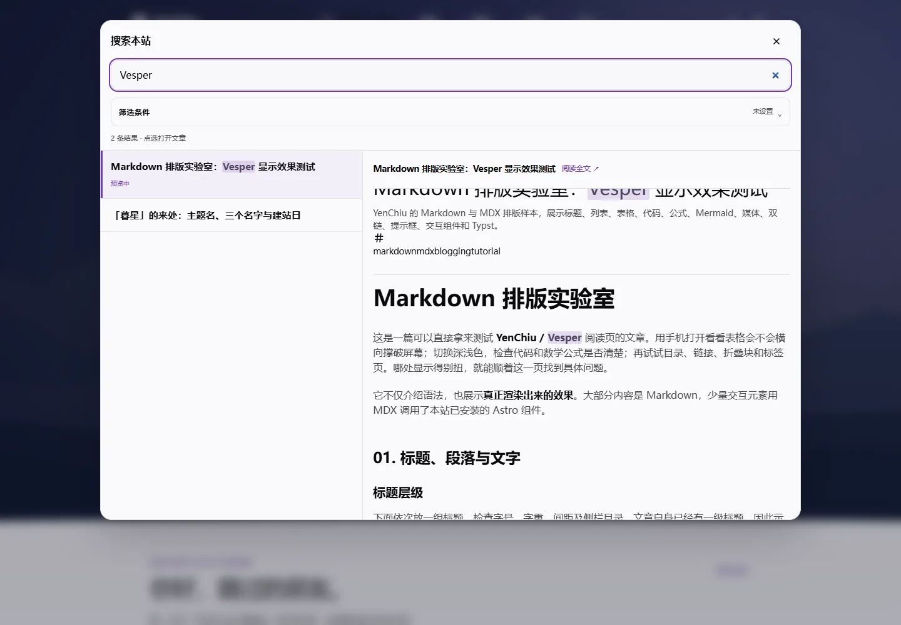
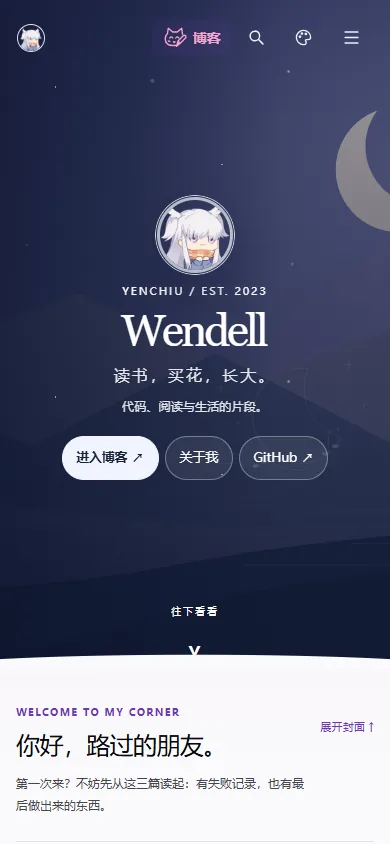
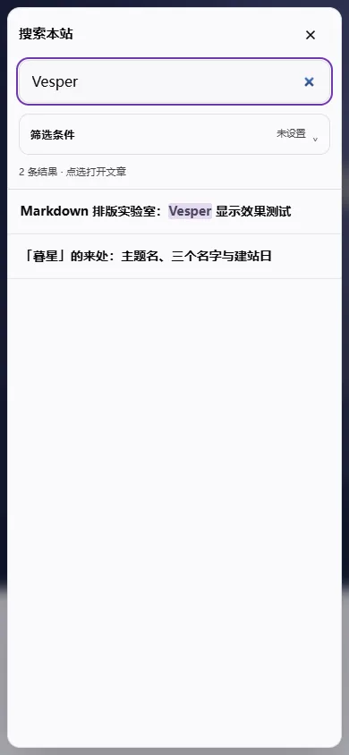

<p align="right">
  <a href="./README.md"></a>
  <a href="./README-zh-CN.md"></a>
</p>

<div align="center">

# VESPER · 暮星

**在文字、思考与留白之间，安放一处宁静。**

个人网站 · 博客 · 文档 · 《余白》期刊

[**访问网站**](https://yenchiu.com) · [**阅读《余白》**](https://yenchiu.com/journal/) · [**更新日志**](https://yenchiu.com/changelog/)

  

</div>

---
## 关于暮星

**Vesper（暮星）** 是 [Wendell 的个人网站](https://yenchiu.com) 所使用的 Astro 主题，以克制的刊物式排版，串联博客、文档与文学期刊《余白》。

| **01 · 文字** | **02 · 知识** | **03 · 期刊** |
| :--- | :--- | :--- |
| [博客](https://yenchiu.com/blog) | [文档库](https://yenchiu.com/folio/) | [《余白》](https://yenchiu.com/journal/) |
| 随笔、记录与探索 | 资料整理与项目笔记 | 为文字留一处归档之地 |

## 网站实景

以下为本地生产构建的真实截图，沿用现有 Vesper 视觉与 Wendell 头像。

[](https://yenchiu.com/)

| **搜索 · 结果与正文预览** | **时光机 · 日历与写作记录** |
| :--- | :--- |
| [](./docs/assets/showcase/search-desktop.webp) | [](https://yenchiu.com/archives/) |

<details>
<summary><strong>小屏幕上的暮星</strong></summary>

<p align="center">
  
  
  
</p>

</details>

截图信息与资源处理记录见[品牌资源审计](./docs/brand-assets-audit.md)。Iris 原展示截图保留在[上游存档](./migration/upstream-README.md)中。

## 项目概览

| | |
| :--- | :--- |
| **主题** | Vesper（暮星）· `astro-theme-vesper` |
| **主题版本** | v0.1.0 · `theme-v0.1.0` |
| **技术与部署** | Astro · GitHub Actions · GitHub Pages |
| **主题来源** | 衍生自 [Astro Theme Iris](https://github.com/LemonAdorable/astro-theme-iris) |
| **代码仓库** | [yen-chiu/yen-chiu.github.io](https://github.com/yen-chiu/yen-chiu.github.io) |

## 本地运行

需要 **Node.js 24**。

```bash
npm ci
npm run dev -- --host 127.0.0.1
```

生产构建：

```bash
npm run build
```

<details>
<summary><strong>环境说明</strong></summary>

项目的 `.npmrc` 设置了 `legacy-peer-deps`。如果 Windows 环境下 esbuild 遇到临时目录权限问题，可将 `TEMP`、`TMP` 指向工作区内可写目录后重新构建。

</details>

## 子项目维护手册

[子项目文档总览](./docs/README.md) 汇总光影档案、Gallery Studio、夜间留声、首页外观、友情链接和 Avatar Studio 的架构、使用及维护说明。另见 [分支清理与发布规范](./docs/branches.md)，其中记录已合并分支的清理候选及必须保留的独立工具分支。

## 仓库导览

| 路径 | 用途 |
| :--- | :--- |
| `src/content/blog` | 博客文章与分类内容 |
| `src/content/docs` | 文档与主题说明 |
| `src/pages/journal.astro` | 期刊《余白》封面 |
| `src/pages/persona.astro` | 念真页面 |
| `migration/content-manifest.json` | 文章迁移记录与旧地址 |
| `docs/assets/showcase/` | 当前 Vesper 展示截图（WebP） |
| `migration/upstream-assets/` | 上游图片与演示素材存档 |
| `migration/upstream-README.md` | Iris 上游 README 存档 |
| `migration/upstream-examples` | 不参与内容生成的上游示例 |
| `scripts/` | 迁移与校验脚本 |

## 站点沿革

`2023.03 — 2023.10` **Jekyll · huxpro** → `2023.10 — 2026.11` **Jekyll · Chirpy** → `2026.11 —` **Astro · Vesper**

更多记录见[网站更新日志](https://yenchiu.com/changelog/)。推送至 `main` 后由 GitHub Actions 构建，并发布到 GitHub Pages。

## 致谢与许可

Vesper 由 **Astro Theme Iris** 演化而来。本仓库是个人网站，**并非** Iris 官方模板。上游许可与署名保留在 [LICENSE](./LICENSE) 和 [上游 README 存档](./migration/upstream-README.md) 中。

| 内容 | 许可 |
| :--- | :--- |
| 主题及相关代码 | Apache-2.0，保留上游及第三方署名 |
| 原创博客文章与文档 | 除另有说明外采用 [CC BY-NC-SA 4.0](https://creativecommons.org/licenses/by-nc-sa/4.0/) |
| 《余白》原创文章 | 以各期声明为准，当前为 [CC BY 4.0](https://creativecommons.org/licenses/by/4.0/) |
| 摄影、插画及第三方素材 | 以各自许可声明为准 |

详情见[版权与使用说明](https://yenchiu.com/terms/copyright/)。

<details>
<summary><strong>Star History · 展开查看</strong></summary>

[](https://star-history.com/#yen-chiu/yen-chiu.github.io&Date)

</details>

---

<div align="center"><sub>VESPER · 愿文字有处安放。</sub></div>
