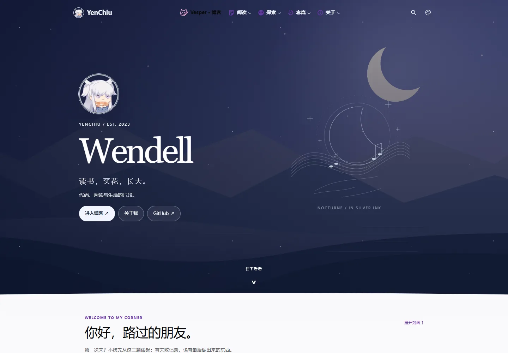
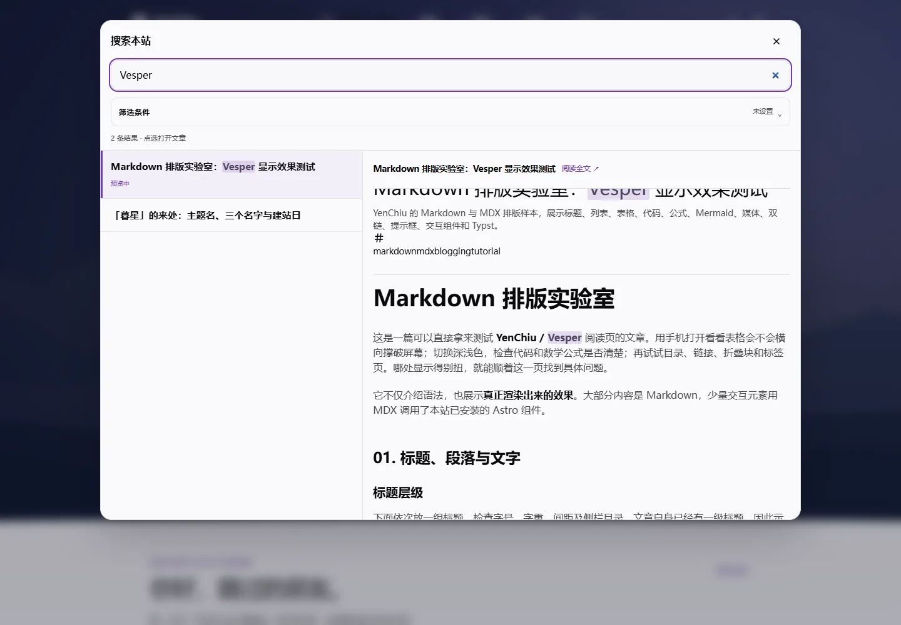
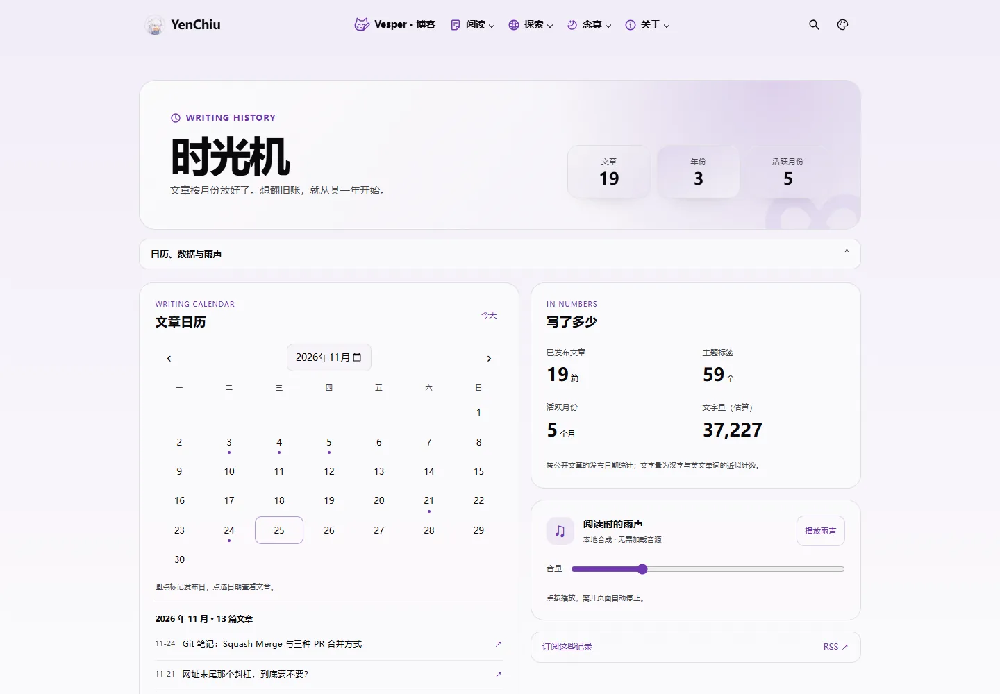
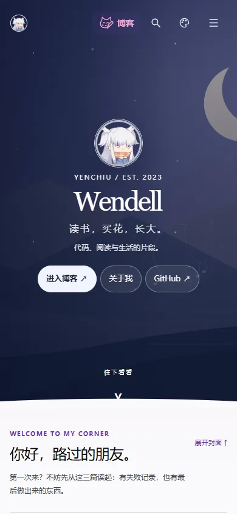
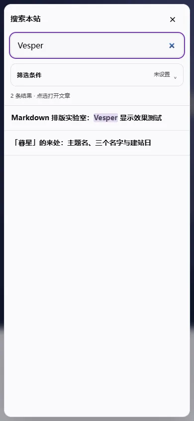
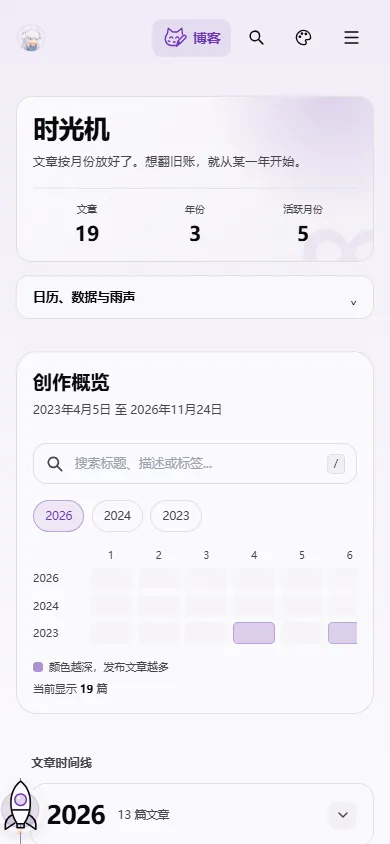

<p align="right">
  <a href="./README.md"></a>
  <a href="./README-zh-CN.md"></a>
</p>

<div align="center">

# VESPER · 暮星

**A quiet place for words, ideas, and the spaces between.**

Personal website · Blog · Documentation · *余白* Journal

[**Explore the website**](https://yenchiu.com) · [**Read the journal**](https://yenchiu.com/journal/) · [**Changelog**](https://yenchiu.com/changelog/)

  

</div>

---
## Overview

**Vesper (暮星)** is the Astro theme behind [Wendell's personal website](https://yenchiu.com). It brings together writing, documentation, and the literary journal *余白* in a restrained editorial layout.

| **01 · Writing** | **02 · Knowledge** | **03 · Journal** |
| :--- | :--- | :--- |
| [Blog](https://yenchiu.com/blog) | [Documentation](https://yenchiu.com/folio/) | [*余白*](https://yenchiu.com/journal/) |
| Essays, notes, and experiments | Reference material and project notes | A home for collected writing |

## Website showcase

Real captures of the local production build, using the existing Vesper artwork and Wendell avatar.

[](https://yenchiu.com/)

| **Search · results and preview** | **Archives · calendar and writing history** |
| :--- | :--- |
| [](./docs/assets/showcase/search-desktop.webp) | [](https://yenchiu.com/archives/) |

<details>
<summary><strong>On a smaller screen</strong></summary>

<p align="center">
  
  
  
</p>

</details>

Capture details and resource decisions: [brand asset audit](./docs/brand-assets-audit.md). Upstream attribution remains in the [archived Iris README](./migration/upstream-README.md); historical screenshots have been removed.

## At a glance

| | |
| :--- | :--- |
| **Theme** | Vesper (暮星) · `astro-theme-vesper` |
| **Theme release** | v0.1.0 · `theme-v0.1.0` |
| **Stack** | Astro · GitHub Actions · GitHub Pages |
| **Origin** | Derived from [Astro Theme Iris](https://github.com/LemonAdorable/astro-theme-iris) |
| **Repository** | [yen-chiu/yen-chiu.github.io](https://github.com/yen-chiu/yen-chiu.github.io) |

## Getting started

Requires **Node.js 24**.

```bash
npm ci
npm run dev -- --host 127.0.0.1
```

Build for production:

```bash
npm run build
```

<details>
<summary><strong>Environment notes</strong></summary>

The project's `.npmrc` enables `legacy-peer-deps`. On Windows, if esbuild encounters temporary-directory permission errors, point `TEMP` and `TMP` to a writable directory inside the workspace before rebuilding.

</details>

## Subproject documentation

See the [maintenance handbook (中文)](./docs/README.md) for Gallery, Gallery Studio, Night Radio, Nocturne Editorial, friend links, and Avatar Studio. The [branch inventory](./docs/branches.md) records verified cleanup candidates and retention requirements. Independent development versions are documented separately from features already on main.

## Repository map

| Location | Purpose |
| :--- | :--- |
| `src/content/blog` | Blog posts and categories |
| `src/content/docs` | Documentation and theme notes |
| `src/pages/journal.astro` | Cover page for *余白* |
| `src/pages/persona.astro` | Nianzhen persona page |
| `migration/content-manifest.json` | Migration records and legacy URLs |
| `docs/assets/showcase/` | Current Vesper screenshots (WebP) |
| `migration/upstream-assets/` | Upstream asset removal record |
| `migration/upstream-README.md` | Archived upstream Iris README |
| `migration/upstream-examples` | Archived examples excluded from content generation |
| `scripts/` | Migration and validation utilities |

## Evolution

`2023.03 — 2023.10` **Jekyll · huxpro** → `2023.10 — 2026.11` **Jekyll · Chirpy** → `2026.11 —` **Astro · Vesper**

Read the [site changelog](https://yenchiu.com/changelog/) for more context. Pushes to `main` are built by GitHub Actions and published to GitHub Pages.

## Credits & licensing

Vesper evolved from **Astro Theme Iris**. This is a personal website repository, **not** the official Iris template. Upstream attribution and licenses are preserved in [LICENSE](./LICENSE) and the [archived upstream README](./migration/upstream-README.md).

| Material | License |
| :--- | :--- |
| Theme and related code | Apache-2.0, retaining upstream and third-party notices |
| Original blog posts and documentation | [CC BY-NC-SA 4.0](https://creativecommons.org/licenses/by-nc-sa/4.0/) unless otherwise stated |
| Original *余白* journal articles | Per-issue terms; currently [CC BY 4.0](https://creativecommons.org/licenses/by/4.0/) |
| Photography, illustrations, and third-party assets | Their own applicable terms |

See the [copyright and usage policy](https://yenchiu.com/terms/copyright/).

<details>
<summary><strong>Star history</strong></summary>

[](https://star-history.com/#yen-chiu/yen-chiu.github.io&Date)

</details>

---

<div align="center"><sub>VESPER · Built for the words that remain.</sub></div>
