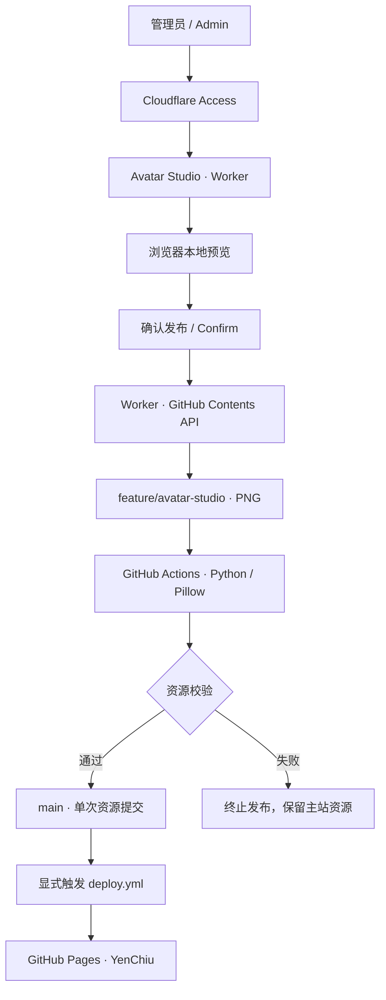

# Avatar Studio

**A private, independent avatar publishing workspace for YenChiu.**  
为 YenChiu / Vesper 提供独立的头像预览、动态资源生成与发布工作台。

[主站 / Website](https://yenchiu.com) · [部署与维护手册 / Operations](studio/README.md) · [CI checks](https://github.com/yen-chiu/yen-chiu.github.io/actions/workflows/avatar-studio-ci.yml) · [Publish history](https://github.com/yen-chiu/yen-chiu.github.io/actions/workflows/avatar-studio-publish.yml)


## 01 · 项目简介 / Overview

Avatar Studio 将头像维护从 Astro 主站构建中分离出来。管理员可以在受 Cloudflare Access 保护的独立界面中选择 PNG、预览静态与微动态效果，并在明确确认后提交发布任务。

- 本地预览：选择图片不会自动上传或发布。
- 独立生成：由 GitHub Actions 使用同一张 PNG 生成无损动态 WebP 与兼容性 GIF。
- 资源校验：检查解码、尺寸、循环、帧数、时长与透明度。
- 原子发布：验证通过后，在 `main` 上以单次 Git 提交更新头像资源集合；允许字节未变化的导出文件保持原样。
- 分支隔离：Studio 的代码、配置和生成流程独立维护，不需要合并到主站。

## 02 · 发布架构 / Architecture



Worker 只暂存源 PNG；独立 Actions 工作流负责生成、校验及发布。预览是 CSS 动画模拟，不是实际编码后的 WebP 或 GIF。提交源图成功并不意味着网站部署成功。

## 03 · 输入与输出 / Asset specifications

| 项目 / Item | 规格 / Specification |
| --- | --- |
| 输入 / Input | 正方形 PNG，128–2048 px，最大 4 MiB |
| 编码 / Encoding | 8-bit RGB、索引色或 RGBA；非隔行 |
| 动态尺寸 / Canvas | 320 × 320 px |
| 动画 / Motion | 垂直微浮动，生成器采样 24 次，每次 120 ms |
| 循环 / Loop | 2880 ms，无限循环；编码器可能合并重复帧 |
| 主站动态格式 / Primary | Lossless animated WebP，保留 alpha |
| 兼容格式 / Fallback asset | Animated GIF，共享调色板、二值透明度 |

| 资源路径 / Asset path | 用途 / Purpose |
| --- | --- |
| `src/assets/avatar.png` | 原始静态头像 |
| `public/favicon/wendell-avatar-animated.webp` | 主站动态头像 |
| `public/favicon/wendell-avatar-animated.gif` | GIF 兼容资源 |

建议输入带透明背景的 PNG。GIF 无法完整保留半透明像素，其边缘效果与 WebP 可能不同。

## 04 · 使用方法 / Usage

部署并配置访问权限后：

1. 登录受 Cloudflare Access 保护的 Studio。
2. 选择满足规格的 PNG，检查静态与微动态预览。
3. 点击「确认更新网站头像」，完成二次确认。
4. 查看 [头像发布工作流](https://github.com/yen-chiu/yen-chiu.github.io/actions/workflows/avatar-studio-publish.yml)，确认生成、验证和资源提交成功。
5. 查看主站部署结果，并实际检查站点头像。

重复提交字节完全相同的源 PNG 不会创建新的暂存提交；如需重试此前失败的生成任务，应重新运行对应 Actions 记录。

## 05 · 本地开发与测试 / Development

从仓库根目录运行。推荐使用 Node.js 24、Python 3.12。

```bash
git clone --branch feature/avatar-studio --single-branch https://github.com/yen-chiu/yen-chiu.github.io.git
cd yen-chiu.github.io

node --check studio/worker.mjs
node --test studio/worker.test.mjs

python -m pip install Pillow==11.3.0
python scripts/generate-avatar-gif.py
python scripts/verify-avatar-assets.py
```

生成脚本会改写工作区中的两个动态头像文件。测试完成后请检查 `git status`，不要误提交测试生成的资源。完整测试无需启动 Astro 或配置生产 GitHub 凭据。

## 06 · 部署与安全 / Deployment & security

将 Worker 部署到独立域名，并通过 Cloudflare Zero Trust Access 保护所有入口。使用单一授权账户及最小范围 GitHub 凭据。

| 配置 / Setting | 用途 / Purpose |
| --- | --- |
| `ACCESS_TEAM_DOMAIN` | Cloudflare Access 团队域名 |
| `ACCESS_AUD` | Access 应用 Audience |
| `OWNER_EMAIL` | 唯一允许登录的邮箱 |
| `GITHUB_TOKEN` | Worker Secret；仅授权目标仓库 Contents 读写 |

完成 Access 配置与 Wrangler 登录后，从本分支执行：

```bash
npx wrangler deploy --config studio/wrangler.toml
```

部署前后均须检查访问控制。Worker 会独立验证签名 JWT、来源、确认头及 PNG 头部；完整图片解码由后续生成流程完成。凭据不得提交到仓库或暴露给浏览器。5 秒冷却仅是单实例防重复点击措施，不是全局限流。

详细部署步骤、失败重试、权限边界和回滚命令见 [技术与运维手册](studio/README.md)。本 README 不代表 Cloudflare 服务已经配置完成或正在运行。

## 07 · 目录结构 / Repository map

| 路径 / Path | 职责 / Responsibility |
| --- | --- |
| [studio/worker.mjs](studio/worker.mjs) | 私有 UI、授权与发布 API |
| [studio/worker.test.mjs](studio/worker.test.mjs) | Worker 单元与访问拒绝测试 |
| [studio/wrangler.toml](studio/wrangler.toml) | Worker 部署配置 |
| [studio/README.md](studio/README.md) | 详细技术与维护手册 |
| [scripts/generate-avatar-gif.py](scripts/generate-avatar-gif.py) | WebP/GIF 同源生成 |
| [scripts/verify-avatar-assets.py](scripts/verify-avatar-assets.py) | 生成资源校验 |
| [.github/workflows/avatar-studio-ci.yml](.github/workflows/avatar-studio-ci.yml) | 独立分支 CI |
| [.github/workflows/avatar-studio-publish.yml](.github/workflows/avatar-studio-publish.yml) | 资源生成、提交及部署触发 |

## 08 · 分支维护 / Maintenance

`feature/avatar-studio` 是长期维护的独立工具分支，而非等待合并的普通功能分支。仓库仍包含从主站继承的 Astro 文件，但它们不是 Studio 运行的必要部分。

- 不删除该分支，不将 Studio 整体合并至 `main`。
- 主站只接收通过验证的头像资源；普通文档或代码提交不会触发头像发布任务。
- 更新生成参数时同步检查两个导出格式、验证脚本与主站兼容性。
- 若生成校验失败，修复后重试；若资源已提交但部署触发失败，按运维手册单独检查及重新触发主站部署。
- 回滚应针对对应头像资源提交，而不是重置整个主站分支。

代码许可及继承的第三方声明见仓库 [LICENSE](LICENSE)。头像及其他视觉素材适用各自的授权条款。

---

**Avatar Studio · YenChiu**  
Independent tooling, shared visual identity.
