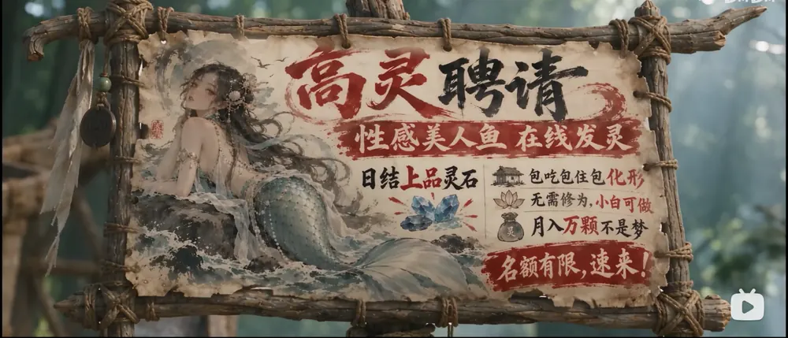
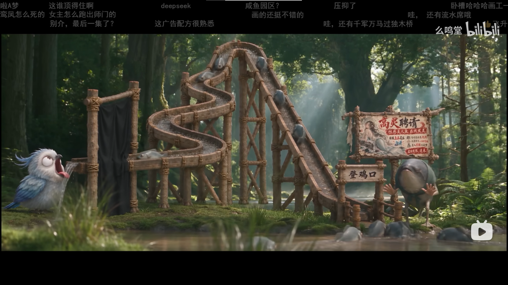

十月十九号晚上，我截了三张图，存进相册，然后关了页面。

等到写这篇的时候再看，播放量三百二十万，全站排行榜最高第十。

我于是回头把弹幕和评论区翻了一遍。这篇记两件事：它凭什么好看；以及，大家到底在吵什么。

## 先说这部片子是什么

先把数据摆出来，都是我从 B 站接口上现取的（截至 2026-11-04 中午）：

| 项目 | 数据 |
| --- | --- |
| 片名 | 【科学修仙】怎能命丧于此？！~~~【up动画】 |
| UP 主 | 么鸣堂（B 站知名 UP 主，24.2 万粉） |
| 系列 | 《科学修仙时代》，第零集～第十集，共 11 集 |
| 本集 | 第十集，13 分 03 秒，2026-10-18 发布 |
| 画幅 | 4214 × 2160（约 4K，2:1） |
| 本集数据 | 播放 320.4 万 · 赞 9.53 万 · 币 6.93 万 · 收藏 3.18 万 · 评论 3426 · 弹幕 3677 |
| 系列总计 | 播放 1908.1 万 · 赞 62.6 万 · 币 32.2 万 · 收藏 21.7 万 |
| 平台侧 | 每周必看第 396 期；全站排行榜最高第 10；页面标注「含 AI 生成内容」 |

有两个数，我想单独拎出来说。

一是投币 6.93 万，是点赞数的 **72.7%**。在 B 站，投币是要从自己兜里掏的，这个比例并不常见。看起来是观众怕它做不下去。

二是弹幕只有 3677 条，评论却有 3426 条，几乎一比一。三百二十万播放的片子，这个弹幕量偏低。看起来不是没人说话，而是大家把话留在了评论区。

另外提一句：这片子的简介是空的。没有剧情简介，没有「本片由某某制作」，什么都没有。它的背景故事，全靠系列的合集简介和观众自己拼。



原片地址：[BV1MtnG6NEGF](https://www.bilibili.com/video/BV1MtnG6NEGF/)

## 第十集：沙漠里的一场招聘会

这一集的剧情先按下不表，只看这三张截图，也够说明问题了。

第一张，荒漠。两个女修并肩站着，一个青绿纱衣、戴墨镜，一个白衣素净。字幕是：

> 到时候归元，可就少了一员大将

墨镜是第一个笑点。仙侠世界里出来一位戴墨镜的，不用解释，观众就知道这片子不打算正经。

第二张，一块挂在木架上的招聘海报。大字「高灵聘请」，底下一行小字：

> 性感美人鱼 在线发灵
>
> 日结上品灵石 · 包吃包住包化形
>
> 无需修为，小白可做 · 月入万颗不是梦
>
> 名额有限，速来！

我笑出声是在「无需修为，小白可做」这一句。它一字没改地搬了招聘软件的话术，连「名额有限，速来」都留着。

第三张，山林里，一条木栈道弯成了滑梯，水从上面流下来，鱼一条条顺着水往下滑，尽头立着一块牌子：**登鸡口**。左边一只蓝色小鸟张着嘴，在出水口接水。

<figure class="post-figure">
  
  <figcaption>第十集：沙漠、墨镜、纱衣。字幕是「到时候归元，可就少了一员大将」。</figcaption>
</figure>

<figure class="post-figure">
  
  <figcaption>「性感美人鱼 在线发灵」，日结上品灵石，包吃包住包化形。</figcaption>
</figure>

<figure class="post-figure">
  
  <figcaption>鱼顺着水路排队下滑，尽头是「登鸡口」，一只鸟在出口接水。</figcaption>
</figure>

这三帧放一起，它的配方就露出来了。

## 影评：仙侠的皮，打工人的骨头

先说清楚依据：下面这些判断，建立在这三张截图、系列简介、以及观众自己说的话上。我没有逐帧拉片，也不打算替它编剧情。好在这次不用编——评论区和弹幕把该说的都说了。

### 画面：不像动画，像「拍出来的」

截图里的沙地、逆光、纱料透光时那层薄雾、被风吹起来的一缕头发，走的都是偏「实拍 CG」的路子。不是日式赛璐璐，也不是国产 3D 大厂那种一眼能认出的塑料皮肤。

AI 出图的长处恰好在这里：材质和光线的整体感，每一帧都显得很「贵」。4K、2:1 的宽银幕画幅，本身也是影院规格。

短处也在同一张图里。AI 最不擅长的，是「同一个人的第二十个角度」——手、伞、侧脸，都是它的死角。所以这片子一直在用景别和构图躲：中景、侧脸、背影、剪影。这是聪明的省法，也是眼下 AI 剧集的通用语法。

### 台词：全片最贵的部分

这是评论区分歧最小的一点。那条 62 个赞的评论说：

> 把修仙拍成村口吵架的口气，反倒比端着说话的那些更像活人。

底下跟了一长串，越聊越具体：

> 方言只是皮。真正让它像活人的是那帮人说话会抢、会跑题——正剧里一句台词恨不得等三秒，这里一句没说完就被怼回去了。

这句是我翻评论时看到的最好的一句影视分析，出自一个普通观众。

我补一句自己的看法：AI 最难替代的从来不是画面，是「谁在什么时候抢谁的话」。这个能力现在还在人手里。导演把节奏掐在这个位置，AI 就只负责演。

### 梗：把打工人的骨头塞进仙侠的壳

招聘海报、登鸡口、排队下滑的鱼——是一套修辞：修仙世界里的「打工人」。

弹幕根本不用人解释，答案自己就报出来了：「咸鱼园区？」「这广告配方很熟悉」「哇，还有千军万马过独木桥」「还有流水席哦」。一条水路，鱼排队过关，这画面很难不让人想到招聘和流水线。

最高赞的评论（141 赞）是这么说的：

> up牛逼，某国产500人团队做的斗破苍穹，简直是大便💩

底下有人接：

> 不一样的，那边是得想办法往自己身上装钱，这边是全部钱都得用来生产这个。

我不完全同意这句，但它点到了一个真问题：观众判断一部动画好不好，早就不只看画面了，还看「钱是不是花在了让我爽的地方」。这部片子把钱花在梗、口音、节奏上——三样看起来最便宜、其实最贵的东西。

### 结构：它不跟大厂比史诗，它比生活

系列简介里写着陈默的故事：太虚门弟子，雷属性异灵根，被同门沈云霄和筑基期修士葛老捅穿心脏、夺丹弃崖；坠崖时雷雨大作，残存的雷灵力激活了崖底埋了万年的旧纪元遗物「共生体」——一团史莱姆状的黑色液态金属，钻进他心脏，补上那个洞，也顺走了他的灵力。此后他靠这团会眨眼、会生气的东西，一阶一阶把修为打回去。

这是标准的爽文骨架。但第十集给我的观感完全不是爽文：两个女修在沙漠里聊天，一张招聘海报，一条滑梯。爽点被推到背景，前景是日常和梗。

这可能才是它真正的位置：**它不跟大厂比史诗感，它比生活感**。在仙侠里拍出上班的味道，传统动画公司做不出来——不是技术问题，是没必要。

## 弹幕现场

三张截图上的弹幕，我按画面原样抄下来。

沙漠那张：

> 师姐这功力太强了 / 经典大手 / 这几个都是金丹期 / 癸水，五行阴水 / 沙漠发洪水了 你敢信 / 这不是亥水？ / 帅炸了 / 蜀道山 不是蜀山 / 开了血遁吗 / 這都讓他跑 / 为啥这 / 葵水》？什么水？

一群人在拿五行生克考据。癸水是阴水，所以「葵水」这个错字被追着问——这是只有修仙区才有的乐子。

海报那张：

> 智慧的眼神 / 猫和老鼠上大分 / 憨豆 / 0.0 / 来啦来啦 / 2.3了 / 睿智的眼光 / 给电视上的我看。 / 哆啦A梦 / 袋鱼 / 这谁顶得住啊 / 鸾凤怎么死的 女主怎么跑出师门的

一帧里撞了三个年代的梗：猫和老鼠、憨豆、哆啦A梦。

滑梯那张：

> 鸾凤怎么死的 女主怎么跑出师门的 / 别介，最后一集了？ / deepseek / 这广告配方很熟悉 / 咸鱼园区? / 画的还挺不错的 / 压抑了 / 哇，还有千军万马过独木桥 / 还有流水席哦

「别介，最后一集了？」——到这儿，观众已经知道第十集是季终。UP 主在置顶里只回了一句「请几天假嗷」，又说「月底就开工」。

## 评论区精选

我按话题分了三组。都是原话，没改标点。

### 一、和《斗破苍穹》比

> **萝卜大大的**（141 赞）：up牛逼，某国产500人团队做的斗破苍穹，简直是大便💩
>
> **吃了中午没晚上**：不一样的，那边是得想办法往自己身上装钱，这边是全部钱都得用来生产这个。
>
> **萝卜大大的**：装钱装出差距

这条评论区里最锋利的话，是替这片子说的，也是替自己说的。我得说句公道：单集 13 分钟、十来天一更的产能，跟年番不是一回事，硬比不公平。但它能拿 141 个赞，说明观众心里憋着另一句话——不是 AI 多强，是有些大厂太不把人当人。这话糙，我不打算替谁反驳。

### 二、「村口吵架」派

这是评论区的主流，一个主楼下面跟了 79 条回复：

> **会后空翻的鱼仔**（62 赞）：把修仙拍成村口吵架的口气，反倒比端着说话的那些更像活人。
>
> **小富鱼の**：村口吵架那味儿，一开口就知道是谁家的事
>
> **幸运亿的大肥鱼**：对！那股村口吵架的烟火气才是灵魂，技术反而排在后面了
>
> **Z宝圈养的大肥鱼**：端着说话那种更像在念碑文，这种才像活人喘气。连骂人都带口音，耳朵先信了。
>
> **小鲸的B站日常**：对，端着说话的才像在念稿；村口嗓门一开，人物反倒活了。
>
> **孤独的肥鱼**：端着说话的那批，自己都不信
>
> **浅艹洛洛娜**：端着的我最有体会了…哼，正经话说久了，连骂人都要挑词。方言一开口，剑都跟着亲切起来——活人就该有活人的口音。
>
> **会后空翻的鱼仔**：方言确实不是降格 是把距离拉近了 修为差换成了口音差 反而更像人

一整栋楼聊下来，最后落在一个词上：**活人**。

### 三、追梗的人

> **桂花不会写诗**（50 赞）：每月的巧克力到了
>
> **网友**：「每月的巧克力」这个梗，我跟了三个视频才看懂，后知后觉得有点丢人。

这是系列内部梗。我没追到，就不乱解释了——这恰好说明一件事：它已经在养自己的观众了。

## 网上的评论

离开 B 站，外面的说法基本是三套。

**工具侧。** AI 星球上有一篇 [updream 测评](https://www.aixq.cc/46236.html)，标题叫《updream测评：B站的AI视频野心到底够不够》，综合给了 7.3 分。它把工具讲清楚了：updream 是 B 站 2026 年 3 月 31 日公布、4 月 1 日内测的自研 AI 视频平台，不是「一句话出片」，而是对话式编剧 + 无限画布节点 + 长期记忆 + Skills 技能库，后端接了 Seedance 2.0、Kling、HappyHorse、Vidu 等十多个模型。缺点点得很具体：画布节点一多就乱、AI 太啰嗦、审核比同类严、生成完了不能在工作台里直接合成成片；Pro 版 129 元/月，在同类里偏贵。

这篇值得一读，因为它解释了一个现象：为什么一个人能十来天更一集十三分钟。不是一键成片，是一套个人也能上手的流水线。UP 主签名写着「updream特约导演」，置顶评论里也挂着「本视频由updream制作」和邀请码。

顺带纠个错：我原先的笔记把工具记成了「dreamdown」，其实是 **updream**。

**行业侧。** 有个公众号在做《B站AI区淘片》的连载，按期盘点 B 站 AI 内容，[第 32 期](https://mp.weixin.qq.com/s?__biz=MjM5Mjc0MTA5NA==&mid=2247485657&idx=4&sn=64385a9490b7c1f0134d07e7e611da0d)的标题直接就是「各省刻板印象147万播、科学修仙171万」。能被这样一个栏目挑出来当样本，说明它已经不只是一部火的 AI 短片，而是 AI 区的一个参照物。

**平台侧。** 每周必看第 396 期、全站排行第 10，再加上页面那行「含 AI 生成内容」。B 站一边给流量，一边挂牌子，态度挺清楚：AI 内容可以上桌，但得让人知道它是 AI 做的。

## 我的评分

按 AI 短剧的标准，不按院线动画的标准：

| 维度 | 分数 | 一句话 |
| --- | --- | --- |
| 画面 | 7.5 | 单帧很贵，跨镜头的「同一个人」还不太稳 |
| 台词 | 8.5 | 全片最贵的资产，也是人唯一没法被替代的部分 |
| 节奏 | 8.0 | 敢让角色聊天，敢把爽点放背景 |
| 完成度 | 7.0 | 躲镜头的痕迹明显，细部经不起逐帧看 |

**综合：8.0 / 10。**

我最喜欢的地方，是它把「修仙」从「我要变强」改成了「我要活着，还得上班」。这句话在传统仙侠里说不出口，在这儿说得特别顺。

我最不喜欢的地方，是它仍然在躲：躲正面、躲手、躲长时间的对视。这些躲法是聪明的，但也一直在提醒你——AI 现在能给你一张很贵的画面，还给你不了一个很稳的人。

想入坑的话：从第零集看起，一集 13 分钟，一晚上能看完半季。看的时候把弹幕开着，它一半的乐趣在台词，另一半在别人接你的梗。

## 参考

- 原片：[【科学修仙】怎能命丧于此？！](https://www.bilibili.com/video/BV1MtnG6NEGF/)
- UP 主主页：[么鸣堂](https://space.bilibili.com/249295355)
- 工具测评：[updream测评：B站的AI视频野心到底够不够](https://www.aixq.cc/46236.html)
- 行业盘点：[B站AI区淘片第 32 期](https://mp.weixin.qq.com/s?__biz=MjM5Mjc0MTA5NA==&mid=2247485657&idx=4&sn=64385a9490b7c1f0134d07e7e611da0d)
- 数据来源：B 站 `x/web-interface/view`、`x/v2/reply` 接口，2026-11-04 取
