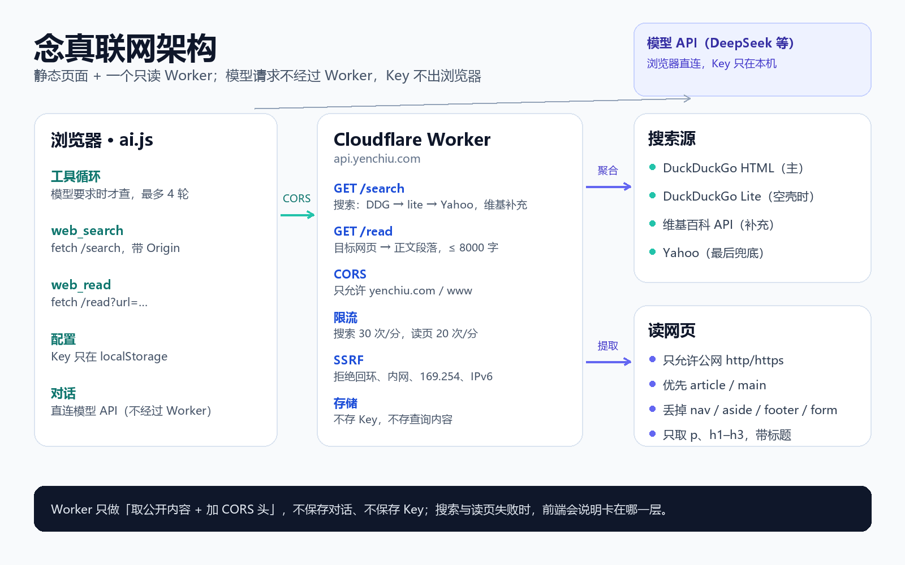

念真这个聊天页有一个很硬的约束：**它是纯静态的**。没有服务器、没有数据库，API Key 只存在访问者自己的浏览器里，对话请求由浏览器直接发往模型服务商。这样隐私边界很清楚，但也意味着——她想去网上查点东西，浏览器得直接去敲别人的门。

而浏览器敲门，大多数时候会被 CORS 挡在门外。

这篇把「念真上网」这件事拆开：为什么不能直连、Worker 在中间做什么、搜索和读页各自怎么降级、配置怎么迁移，以及上线前到底验证了什么。



## 一、先承认约束：浏览器不是万能的

最开始的想法很自然：让页面直接 `fetch` 维基百科、DuckDuckGo，再不行找个 SearXNG。实测下来，几条路各有各的问题：

| 方案 | 结论 | 原因 |
| --- | --- | --- |
| 维基百科 API（`origin=*`） | 可用，但不稳 | 允许跨域，可中文维基在部分网络环境不可达 |
| DuckDuckGo 即时摘要 | 浏览器直连不可用 | 实测不返回 `Access-Control-Allow-Origin`，CORS 必拦 |
| SearXNG 公共实例 | 要自己加头 | 默认不开 CORS，公共实例也不保证稳定 |
| `r.jina.ai` 读页 | 已失效 | 匿名请求返回 401，不能再当默认值 |
| 自建 Cloudflare Worker | 可用 | 服务端取内容、统一加 CORS 头，最稳 |

所以最终方案不是「让浏览器变强」，而是**在中间放一个只读的 Worker**：

```
浏览器（念真页面）
   │  GET https://api.yenchiu.com/search?q=…
   ▼
Cloudflare Worker
   │  服务端 fetch DuckDuckGo / 维基 / Yahoo
   ▼
返回 { results: [...] }，带 CORS 头
```

关键点先说清楚：**模型请求不经过这个 Worker**。对话仍然是浏览器直连 DeepSeek（或你填的任何 OpenAI 兼容接口），Key 不进 Worker，也不进本站服务器。Worker 只负责「把公开内容取回来」。

## 二、整体分工

整条链路只有三个角色：

1. **浏览器里的 `ai.js`**：负责工具循环。模型要求搜索时，它去 `fetch` Worker；拿到结果后塞回 `tool` 消息，再让模型组织回答。
2. **Cloudflare Worker（`api.yenchiu.com`）**：两个只读路由，`/search` 和 `/read`。做来源校验、限流、SSRF 防护，然后把结果整理成前端能直接用的形状。
3. **上游**：DuckDuckGo、维基百科、Yahoo，以及被读取的目标网页。

Worker 同时还承担写作台的 GitHub 设备码登录代理（`/device/code`、`/device/token`）。同一份代码、同一个域名，两类用途互不影响。

## 三、一次联网请求的完整时序

以「帮我查一下苏轼是谁」为例：

1. 用户发消息；页面确认「本地工具」开着、人格是念真。
2. 前端从 `skills/skills.json` 里筛出念真可用的技能，生成工具 schema 一起发给模型。
3. 模型返回 `tool_calls: web_search({query:"苏轼"})`。
4. `runTool()` 调 `webSearch()`，浏览器向 `api.yenchiu.com/search` 发请求，带上 `Origin: https://yenchiu.com`。
5. Worker 校验来源、按 IP 限流，然后去上游取结果。
6. Worker 返回 `{results:[{title,url,snippet,source}]}`，前端把它格式化成带「来源」的文本。
7. 工具卡片插进对话，结果作为 `role: tool` 消息回给模型。
8. 模型基于结果写第二轮回答；这一轮最多循环 4 次。

工具模式下页面会**关掉流式输出**。原因很简单：工具调用本身就是一次非流式 JSON 往返，等工具跑完再一次性把最终回答交给吐字动画，比半路插入流更稳。

## 四、搜索：DuckDuckGo 为主，维基补充，Yahoo 兜底

搜索不是「维基优先」。维基百科适合概念、人物、事件，但对「最新模型」「今天天气」这类问题并不合适；而且它在部分网络里根本连不上。

现在的顺序是：

1. **DuckDuckGo HTML**（`html.duckduckgo.com/html/?q=`）：通用网页搜索，中文结果稳定。解析 `result__a` 和 `result__snippet`，并把 `uddg=` 跳转还原成真实地址。
2. **DuckDuckGo Lite**（`lite.duckduckgo.com/lite/`）：HTML 版偶尔会返回空壳（反爬挑战），这时换精简版再试一次。
3. **Yahoo**：DDG 两个入口都空时接手。解析结果页，并把 `r.search.yahoo.com/.../RU=<url>/` 还原成目标地址。
4. **维基百科 API**：和 DDG 并行跑，作为补充源合并进来。
5. **DuckDuckGo 即时摘要**：最后的兜底，只适合「是什么」类问题。

合并时按 URL 去重，最多返回 6 条，并给每条标上 `source`。前端会把来源拼成「来源：DuckDuckGo / 维基百科」，模型回答时就能说清「这是查到的」还是「我本来就知道的」。

核心逻辑大概是这样：

```js
async function searchUpstream(q) {
  const [ddg, wikipedia] = await Promise.allSettled([
    searchDuckDuckGoHtml(q),
    searchWikipedia(q)
  ]);

  let general = ddg.status === 'fulfilled' ? ddg.value : [];
  if (!general.length) general = await searchDuckDuckGoLite(q).catch(() => []);
  if (!general.length) general = await searchYahoo(q).catch(() => []);

  const merged = dedupeByUrl([
    ...general,
    ...(wikipedia.status === 'fulfilled' ? wikipedia.value : [])
  ]).slice(0, 6);

  return merged.length ? merged : searchDuckDuckGo(q).catch(() => []);
}
```

每个上游都有 8 秒超时。从 Cloudflare 机房访问这些站点，偶尔会遇到空结果或反爬页，所以「一个源失败就整体失败」是不能接受的——失败原因会被记录下来，但不阻断其他源。

> 中间试过 Bing 的 RSS 搜索，从机房出口拿到过和查询完全无关的结果（甚至是不该出现的内容），果断撤掉了。搜索源也会「看起来能用」和「真的能用」是两回事。

## 五、读网页：把页面变成模型能吃的正文

`/read` 比搜索更危险：它让 Worker 去访问用户给的任意 URL。所以第一层不是解析，是**拒绝**：

- 只允许 `http` / `https`；
- 拒绝 `localhost`、`.local`、回环、内网网段（`10/8`、`172.16/12`、`192.168/16`、`100.64/10`）、link-local（含 `169.254.169.254`）；
- 拒绝 IPv6 字面量，避免绕过网段判断；
- 10 秒超时，非文本内容直接拒绝。

通过之后再取正文：

1. 优先 `<article>`，其次 `<main>`，都没有才用整个 `<body>`；
2. 丢掉 `<nav>`、`<aside>`、`<footer>`、`<form>`；
3. 只保留 `<p>`、`<h1>`–`<h3>` 的段落，避免语言列表、菜单、按钮占满额度；
4. 拼上页面标题，最多 8000 字。

这样维基百科页面不会一上来就是「42 种语言 /  العربية / مصرى …」，模型拿到的是真正的条目正文。

为什么不用 `r.jina.ai`？它现在匿名请求返回 401，而且把要读的 URL 交给第三方也不理想。Worker 自己抓、自己剥，虽然粗糙，但可控。

## 六、前端的三个关键决定

### 1. 默认值必须真的能用

上一版把搜索接口留空、读页默认成 `r.jina.ai`，结果是：新用户开箱即用只是理论上的，实际要么只搜维基，要么读页直接 401。

现在的默认值直接指向站点自己的 Worker：

```js
var SEARCH_ENDPOINT = 'https://api.yenchiu.com/search';
var READER_ENDPOINT = 'https://api.yenchiu.com/read?url={url}';
```

「零配置能用」不是一句文案，是默认值本身要通。

### 2. 旧配置要迁移，但不能覆盖用户的选择

老用户 localStorage 里还留着 `auth.yenchiu.com` 和 `r.jina.ai`。直接改默认值没用，因为已保存的配置优先级更高。所以加了一次性迁移：

```js
if (!saved.endpointVersion || saved.endpointVersion < ENDPOINT_VERSION) {
  if (!saved.readerEndpoint || /^https:\/\/r\.jina\.ai\/?$/i.test(saved.readerEndpoint)) {
    cfg.readerEndpoint = READER_ENDPOINT;
  }
  if (!saved.searchEndpoint) cfg.searchEndpoint = SEARCH_ENDPOINT;
  if (/^https:\/\/auth\.yenchiu\.com\//i.test(saved.searchEndpoint || '')) {
    cfg.searchEndpoint = SEARCH_ENDPOINT;
  }
  cfg.endpointVersion = ENDPOINT_VERSION; // 3
}
```

迁移只做一次，Key、模型、温度这些用户自己的设置原样保留。

### 3. 失败要说清是哪一层

联网失败时，前端不会只丢一句「网络错误」，而是把每一级的失败原因拼出来：

```
这次没联上：搜索代理：HTTP 403；维基百科：Failed to fetch。
可以换个说法；如果一直不通，去设置里看看「联网搜索接口」填得对不对。
```

工具卡片默认折叠，点开才看到检索内容；模型拿到的结果里带来源，回答时也会说明。

## 七、安全与隐私边界

- **Key 不出浏览器**：模型请求直连服务商，Worker 完全不经手。
- **Worker 不落盘**：没有数据库、没有 KV，搜完即走；代码里不写查询日志。
- **来源白名单**：`ALLOWED_ORIGIN` 只允许 `https://yenchiu.com` 和 `https://www.yenchiu.com`，其他站点调用会 403。
- **但白名单不是鉴权**：`Origin` 是客户端自填的，curl 可以伪造。真正兜底的是按 IP 的限流（搜索 30 次/分、读页 20 次/分）和 SSRF 防护。
- **CORS 是浏览器策略，不是服务器权限**：它只能阻止普通网页读取响应，挡不住脚本直接请求。所以 Worker 里该做的校验一个都不能省。
- **读页有上限**：8000 字、10 秒、只读文本，既控制上下文，也控制被滥用。

## 八、上线与验证

Worker 的部署没有走 `wrangler login`，而是直接把 `index.js` 通过 Cloudflare API `PUT` 到脚本上，变量（`GITHUB_CLIENT_ID`、`ALLOWED_ORIGIN`）一起带上。自定义域 `api.yenchiu.com` 绑定后，证书自动签发。

下面是一轮完整的线上验证记录（2026-11-05 凌晨，真实网络，不是 mock 的 Web 请求）。

### 单测

Worker 单测覆盖 16 个用例：CORS 预检、来源拒绝、设备码透传、限流、搜索合并去重、DDG 失败降级、`/read` 的 SSRF 拒绝和正文提取。`node --test` 全过（16/16）。

### 搜索

| 查询 | HTTP | 结果数 | 实际用到的来源 |
| --- | --- | --- | --- |
| 苏轼 | 200 | 6 | DuckDuckGo + 维基百科 |
| 量子纠缠是什么 | 200 | 6 | DuckDuckGo + 维基百科 |
| Cloudflare Workers | 200 | 6 | 维基百科 + Yahoo（DDG 返回空壳，自动降级） |
| 鲁迅 | 200 | 6 | 维基百科 + Yahoo |
| 今天北京天气 | 200 | 6 | 维基百科 + Yahoo |

这组结果说明降级链路真的在工作：DDG 被反爬时没有整体失败，而是切到了 lite / Yahoo；维基百科则一直作为补充源合并进来。

### 读页

| 目标 | HTTP | 正文长度 | 说明 |
| --- | --- | --- | --- |
| 维基「苏轼」 | 200 | 8019 字（含标题） | 开头是词条正文，不是语言列表 |
| example.com | 200 | 187 字 | 短页面，正文完整 |

### 边界与防护

| 用例 | 结果 |
| --- | --- |
| `http://127.0.0.1/x` | 502 `private_host` |
| `ftp://example.com/x` | 502 `bad_protocol` |
| `Origin: https://evil.example` | 403 `origin_not_allowed` |
| OPTIONS 预检 | 204，`Access-Control-Allow-Origin: https://yenchiu.com` |

### 浏览器全链路

用无头 Chrome 打开线上 `ai.html`，在页面上下文里发一句「帮我查一下苏轼，再读一下维基百科的页面」，由本地假模型依次发起两个工具调用：

- 工具卡片 1：`web_search(苏轼)`
- 工具卡片 2：`web_read(维基「苏轼」)` → 工具结果 8053 字（Worker 正文 8019 字 + 来源前缀）
- 模型收到两条 `role: tool` 结果后给出最终回答
- 控制台 0 报错

> 这一轮用假模型是为了稳定触发工具调用，验证的是「页面 → Worker → 上游 → 工具结果 → 第二轮回答」这条链路；搜索、读页的网络请求都是真的。真实模型能否发起工具调用，取决于它是否支持 function calling 以及你填的 Key。

三条基础命令仍然可以直接复现：

```bash
curl -s https://api.yenchiu.com/health
# {"ok":true}

curl -s 'https://api.yenchiu.com/search?q=苏轼' \
  -H 'Origin: https://yenchiu.com'
# {"results":[{"title":"苏轼…","source":"duckduckgo"}, …]}

curl -s 'https://api.yenchiu.com/read?url=https%3A%2F%2Fexample.com' \
  -H 'Origin: https://yenchiu.com'
# Example Domain …
```

## 九、已知限制

- **DDG 会反爬**：同一出口短时间请求多了，HTML 版可能返回空壳，只能靠 lite / Yahoo 兜底，结果质量会波动。
- **维基不是 everywhere**：中文维基在部分网络不可达，所以它只能当补充，不能当主源。
- **Yahoo 也可能限流**：它是最后一道保险，不保证一直有结果。
- **JS 渲染的页面读不了**：Worker 只拿原始 HTML，不做浏览器渲染；知乎、微信公众号这类页面大概率失败。
- **8000 字是硬上限**：长文会被截断，模型只能看到前面部分。
- **工具模式不流式**：为了工具调用的稳定性，最终回答会等工具跑完再一次性吐字。
- **不支持工具调用的模型用不了**：这类模型会退化成普通对话，念真只能说「我查不了」。

## 十、复盘

这件事最大的教训不是「怎么绕过 CORS」，而是：

1. **「代码写了」不等于「功能上线了」**。Worker 路由在仓库里躺了一版，线上却是 404；默认值指向一个已经 401 的第三方，用户看到的就是「联网坏了」。
2. **默认值就是产品**。让用户自己去设置里填接口，等于把可用性外包给了用户。
3. **降级链路要真的逐级测过**。维基能通、DDG 被 CORS 拦、Bing 返回脏结果、jina 要 Key——这些都不是看文档能知道的。
4. **失败信息要能定位**。把「哪一层、什么状态码」带回来，比一句「网络错误」有用得多。

现在的念真，在 `yenchiu.com/chat/` 打开「本地工具」后，就能查公开资料、读网页，并在回答里说清来源。她不假装能直连，也不假装查过——这大概是一个纯静态站能给出的、比较诚实的联网方案。
