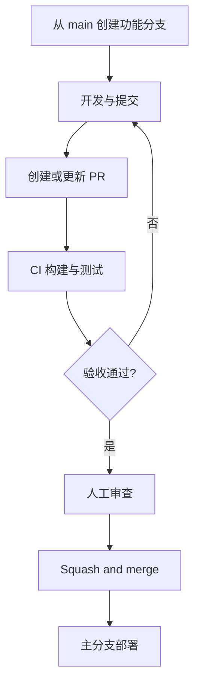

开发一个新功能时，提交记录很容易变成流水账：搭页面、修样式、补测试、修构建，再修一次测试。每一笔在开发过程中都有用，但翻看主分支时，我更希望看到的是「新增了什么功能」，而不是几十条中间步骤。

GitHub 的 Squash Merge（压缩合并）恰好适合这种情况。它把一个 Pull Request 的改动整理成目标分支上的一次提交。这里顺便记一下 Git 分支和三种合并方式的区别。

## 一、分支是从哪里来的？

以个人网站为例，`main` 用来维护正式版本，另开一个 `feat/gallery` 来开发相册：

```bash
git switch main
git pull --ff-only
git switch -c feat/gallery
```

新分支指向创建时的提交，并继承此前的历史。Git 不需要为此重新复制整个项目，更不需要从零开始建站。

```text
main          A --- B --- C
                     \
feat/gallery          D --- E --- F
```

这里两个分支共同拥有 A、B，之后分别演进。C 是主分支的新改动，D、E、F 是相册开发的提交。

开发完成后：

```bash
git add src/pages/gallery/
git commit -m "feat: add gallery page"
git push -u origin feat/gallery
```

在 GitHub 创建从 `feat/gallery` 到 `main` 的 Pull Request（PR）。以后再向这个开发分支推送提交，原来的 PR 会自动更新，无需反复新建。

## 二、三种合并方式

假设 D、E、F 是一个功能的三次开发提交。合并结果大致如下，字母表示提交，S 表示压缩后的新提交，M 表示合并提交。

### Merge Commit：保留完整分支历史

```text
A --- B --- C -------- M  main
       \              /
        D --- E --- F
```

主分支可以追溯开发分支的每一次提交，还多了一个记录合并关系的 M。适合希望保留分支结构、逐次审查改动的项目。

### Squash Merge：一个 PR 对应一次提交

```text
A --- B --- C --- S  main
       \
        D --- E --- F  feat/gallery
```

S 包含本次 PR 最终被合入的变更。D、E、F 不会成为 main 的独立祖先提交；原分支也不会因此被改写。

例如，开发分支上可能有这些记录：

```text
feat: add gallery
fix: adjust responsive layout
test: add gallery smoke tests
fix: correct image dimensions
```

压缩合并之后，主分支只增加一条：

```text
feat: add photography gallery and tests
```

### Rebase Merge：逐次提交，线性历史

```text
A --- B --- C --- D' --- E' --- F'  main
```

每个开发提交被重新应用到目标分支，形成线性的提交历史。新的提交 SHA 与原先不同。适合已经整理得比较清楚、值得单独保留的提交。

| 方式 | 主分支新增提交数（示例） | 特点 |
| --- | ---: | --- |
| Merge Commit | 4 | 三次开发提交加一次合并提交 |
| Squash Merge | 1 | 一个功能对应一个提交 |
| Rebase Merge | 3 | 保留各次改动，历史呈线性 |

## 三、GitHub 上怎么操作？

1. 打开对应的 Pull Request，确认 base 是 `main`，compare/head 是开发分支。
2. 如果 PR 仍是草稿，点击 **Ready for review**。
3. 检查 Files changed、自动化测试结果和合并冲突，满足仓库的审查要求。
4. 在合并按钮的下拉菜单中选择 **Squash and merge**。
5. 修改最终的提交标题、说明，再点击 **Confirm squash and merge**。

如果菜单中没有 Squash and merge，检查仓库 Settings → General → Pull Requests 中是否启用了 Allow squash merging。还需要相应的仓库权限，并遵守分支保护规则。

对于以短期功能分支为主的个人项目，可以只允许 squash merging。是否自动删除已合并的分支，要根据后续是否还需要保留分支决定。

## 四、命令行也能做到

在确认工作区干净、远端分支已经更新的前提下：

```bash
git fetch origin
git switch main
git pull --ff-only origin main
git merge --squash origin/feat/gallery
git status
git diff --cached
# 执行项目的测试和构建，通过后再提交
git commit -m "feat: add photography gallery"
```

`git merge --squash` 会准备合并后的工作区和暂存区，但不会自动产生提交，也不建立普通 merge commit 的双亲关系。需要自己审查暂存内容并执行 commit。

这段命令用于理解原理或本地合并流程。如果仓库要求通过 PR 审查，就在 GitHub 中完成合并，不要为了方便直接推送 main 绕过检查。

## 五、几个值得记住的细节

**主分支更新了怎么办？** 开发分支不会自动同步 main。合并前先检查差异和冲突；必要时更新开发分支，重新运行测试。即使没有冲突，也要检查两边的改动组合后是否仍能正常工作。

**压缩会删除原提交吗？** 不会直接删除或重写开发分支上的提交。但它们没有作为独立提交进入 main。PR 通常仍保留审查及提交记录；如果还需要长期保存原始提交，应保留分支或标签，而不能依赖 PR 充当永久备份。

**可以一直沿用同一个开发分支吗？** 不建议在 squash 后继续长期使用原功能分支，因为旧提交没有成为 main 的祖先，后续 PR 可能重复列出旧提交或增加冲突处理成本。下一项独立功能通常从最新 main 创建新分支。

**压缩合并就能消除错误或密钥泄漏吗？** 不能。它整理的是提交历史，不验证代码的正确性，也不能保证从旧分支或其他引用中移除敏感信息。误提交密钥时，应立即撤销并更换密钥，再处理历史清理。

## 六、个人网站的工作流



对个人博客来说，一个短期 PR 对应一个相对完整的改动，比如摄影相册、音乐播放器或一次文章布局修复。开发分支可以保留细碎的修复过程，main 则以完整的功能为单位记录变更。

不过，CI 通过也不代表一切都已经验收完成。涉及云存储、外部服务、真实设备时，还要检查相应的实际运行环境。提交历史干净只是维护体验的一部分。

## 参考资料

- [GitHub Docs：Pull request merges](https://docs.github.com/en/pull-requests/reference/pull-request-merges)
- [Git 官方文档：git merge](https://git-scm.com/docs/git-merge)
