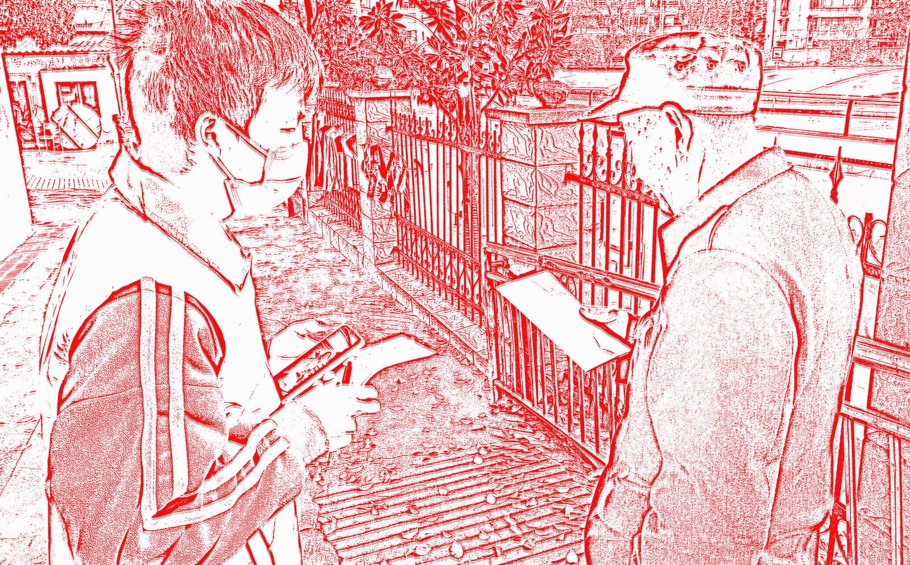
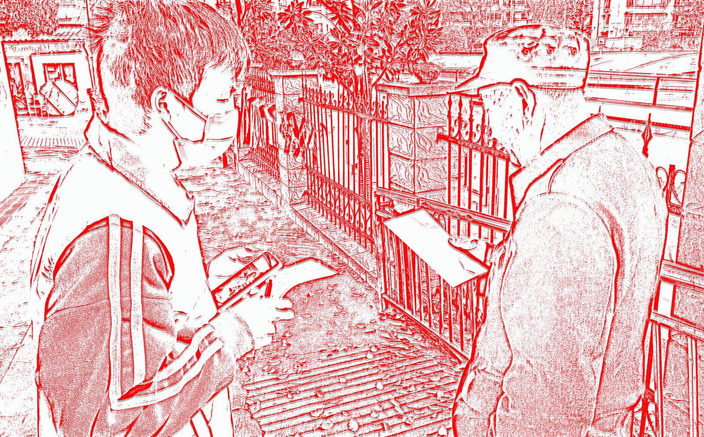
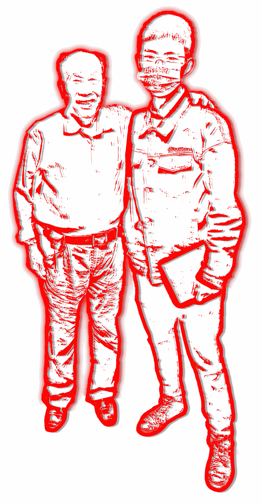

4 月，我和同伴到长沙浏河社区采访周德仁老人。他在海军服役过二十年，已经八十多岁了。我们原本准备进楼找人，结果连采访对象的面都见过了，还没认出来。

楼下有位老人正忙着扫地，我们从旁边走过去，进楼、上楼，一路找不到人，只好给周老打电话。楼道里能听见电话那头的声音，我们又沿着声音找到了楼顶——那里没有周老，倒有一只突然出现的拉布拉多，把同行的人吓了一跳。绕了一圈才反应过来：**刚才楼下扫地的，就是周老。**

他把我们带进一楼的休息室。老人精神很好，平时也会在小区打扫卫生。他谈起运动和生活习惯时，我忍不住夸他，说他是我见过的八十多岁老人里精神状态最好的一个。他的回答出乎意料：

> 我们共产党员不要攀比。

原本准备好的客套话，一下子接不上了。

谈话里最让我好奇的是日记。周老建议我们以后工作了也坚持记录，既记生活，也记读到的新闻和自己的想法。他保存着多年写下的日记和收集的报纸，光我们见到的日记本就有五十多本。几十年下来，一页一页写满，想想都挺不容易。

休息室的墙上还有一张黑白全家福，照片里是一对年轻夫妇和三个孩子。周老说起家人的经历：孩子读书时自己想办法挣生活费，后来有人出国留学，如今三个孩子都在长沙工作。日记本、旧报纸、全家福放在同一个房间里，比任何事先准备的采访提纲都更能让人感觉到时间走过的痕迹。

周老也谈了不少“艰苦奋斗”的事。我当然记得这些话，但这次采访留在我脑子里的，还有更生活化的细节：每天扫地、持续写日记、说起家人时翻出的旧照片，以及我们找了半天才发现他就在楼下的那一幕。

几十本日记就摆在那里。他劝我们记录生活，这话还真不是随口说说。

同一组题材的剪纸版本：

