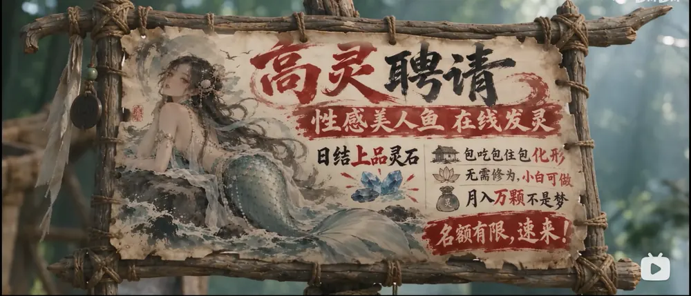

十月十九号晚上，我截了三张图，存进相册，然后关了页面。

等到写这篇的时候再看，播放量三百二十万，全站排行榜最高第十。

我于是回头把弹幕和评论区翻了一遍。这篇记两件事：它凭什么好看；以及，大家到底在吵什么。

## 先说这部片子是什么

先把数据摆出来，都是我从 B 站接口上现取的（截至 2026-11-04 中午）：

| 项目 | 数据 |
| --- | --- |
| 片名 | 【科学修仙】怎能命丧于此？！~~~【up动画】 |
| UP 主 | 么鸣堂（B 站知名 UP 主，24.2 万粉） |
| 系列 | 《科学修仙时代》，第零集～第十集，共 11 集 |
| 本集 | 第十集，13 分 03 秒，2026-10-18 发布 |
| 画幅 | 4214 × 2160（约 4K，2:1） |
| 本集数据 | 播放 320.4 万 · 赞 9.53 万 · 币 6.93 万 · 收藏 3.18 万 · 评论 3426 · 弹幕 3677 |
| 系列总计 | 播放 1908.1 万 · 赞 62.6 万 · 币 32.2 万 · 收藏 21.7 万 |
| 平台侧 | 每周必看第 396 期；全站排行榜最高第 10；页面标注「含 AI 生成内容」 |

有两个数，我想单独拎出来说。

一是投币 6.93 万，约为点赞数的 **72.7%**。这个比例让我意外，但单凭它还看不出观众为什么投币，更不能直接算出制作经费。至少能确定：愿意点投币的人不少。

二是弹幕 3677 条、评论 3426 条，数量接近。至于它们在 B 站同类视频里算高算低，得找同口径的样本比较；我这里只记录当时的数据，不替观众猜动机。

另外提一句：这片子的简介是空的。没有剧情简介，没有「本片由某某制作」，什么都没有。它的背景故事，全靠系列的合集简介和观众自己拼。

[在哔哩哔哩观看](https://www.bilibili.com/video/BV1MtnG6NEGF/)

原片地址：[BV1MtnG6NEGF](https://www.bilibili.com/video/BV1MtnG6NEGF/)

## 第十集：沙漠里的一场招聘会

这一集的剧情先按下不表，只看这三张截图，也够说明问题了。

第一张，荒漠。两个女修并肩站着，一个青绿纱衣、戴墨镜，一个白衣素净。字幕是：

> 到时候归元，可就少了一员大将

墨镜是第一个笑点。仙侠世界里出来一位戴墨镜的，不用解释，观众就知道这片子不打算正经。

第二张，一块挂在木架上的招聘海报。大字「高灵聘请」，底下一行小字：

> 性感美人鱼 在线发灵
>
> 日结上品灵石 · 包吃包住包化形
>
> 无需修为，小白可做 · 月入万颗不是梦
>
> 名额有限，速来！

我笑出声是在「无需修为，小白可做」这一句。它一字没改地搬了招聘软件的话术，连「名额有限，速来」都留着。

第三张，山林里，一条木栈道弯成了滑梯，水从上面流下来，鱼一条条顺着水往下滑，尽头立着一块牌子：**登鸡口**。左边一只蓝色小鸟张着嘴，在出水口接水。

<figure class="post-figure">
  
  <figcaption>第十集：沙漠、墨镜、纱衣。字幕是「到时候归元，可就少了一员大将」。</figcaption>
</figure>

<figure class="post-figure">
  
  <figcaption>「性感美人鱼 在线发灵」，日结上品灵石，包吃包住包化形。</figcaption>
</figure>

<figure class="post-figure">
  
  <figcaption>鱼顺着水路排队下滑，尽头是「登鸡口」，一只鸟在出口接水。</figcaption>
</figure>

这三帧放一起，它的配方就露出来了。

## 影评：仙侠的皮，打工人的骨头

先说清楚依据：下面这些判断，建立在这三张截图、系列简介、以及观众自己说的话上。我没有逐帧拉片，也不打算替它编剧情。好在这次不用编——评论区和弹幕把该说的都说了。

### 画面：不像动画，像「拍出来的」

截图里的沙地、逆光、纱料透光时那层薄雾、被风吹起来的一缕头发，走的都是偏「实拍 CG」的路子。不是日式赛璐璐，也不是国产 3D 大厂那种一眼能认出的塑料皮肤。

至少在我保存的几帧里，材质和光线挺能唬人：纱料透光、逆光下的头发，都不像廉价的静态贴图。不过高分辨率不等于镜头连贯，单帧好看也不能代替整段的动作表现。

短处在截图里反而不容易看：人物换角度是否稳定、动作有没有穿帮、镜头之间接得顺不顺，得看连续画面才知道。我没有逐帧拉片，所以先不把「它一直在躲镜头」写成确定事实。

### 台词：全片最贵的部分

这是评论区分歧最小的一点。那条 62 个赞的评论说：

> 把修仙拍成村口吵架的口气，反倒比端着说话的那些更像活人。

底下跟了一长串，越聊越具体：

> 方言只是皮。真正让它像活人的是那帮人说话会抢、会跑题——正剧里一句台词恨不得等三秒，这里一句没说完就被怼回去了。

这句是我翻评论时看到的最好的一句影视分析，出自一个普通观众。

我更在意的还是台词怎么接：谁抢话、谁跑题、谁半句没说完就被怼回来。比起单张画面的精致，这种节奏更容易让我记住人物。至于每一句是谁写的、具体由哪些工具完成，只有创作团队才能说清。

### 梗：把打工人的骨头塞进仙侠的壳

招聘海报、登鸡口、排队下滑的鱼——是一套修辞：修仙世界里的「打工人」。

弹幕根本不用人解释，答案自己就报出来了：「咸鱼园区？」「这广告配方很熟悉」「哇，还有千军万马过独木桥」「还有流水席哦」。一条水路，鱼排队过关，这画面很难不让人想到招聘和流水线。

我摘录的一条评论当时有 141 个赞：

> up牛逼，某国产500人团队做的斗破苍穹，简直是大便💩

底下有人接：

> 不一样的，那边是得想办法往自己身上装钱，这边是全部钱都得用来生产这个。

我不完全同意这个说法，不过它提醒了我：看动画的时候，我确实会在意台词、口音和节奏，而不只是盯着建模精度。至于一部作品的预算具体花在哪儿，光凭成片看不出来。

### 结构：它不跟大厂比史诗，它比生活

系列简介里写着陈默的故事：太虚门弟子，雷属性异灵根，被同门沈云霄和筑基期修士葛老捅穿心脏、夺丹弃崖；坠崖时雷雨大作，残存的雷灵力激活了崖底埋了万年的旧纪元遗物「共生体」——一团史莱姆状的黑色液态金属，钻进他心脏，补上那个洞，也顺走了他的灵力。此后他靠这团会眨眼、会生气的东西，一阶一阶把修为打回去。

这是标准的爽文骨架。但第十集给我的观感完全不是爽文：两个女修在沙漠里聊天，一张招聘海报，一条滑梯。爽点被推到背景，前景是日常和梗。

第十集最戳我的地方，是**修仙世界居然有了上班的味道**。不是说传统动画做不出这些桥段，而是这种一本正经胡说八道的节奏，正好对上了我的笑点。

## 弹幕与评论：挑几条有意思的

我在原文里记下了不少弹幕和评论。这里留几条最能说明观众在聊什么的，其他就不挨个抄一遍了。**以下为当时的文字摘录，暂未附单条评论的永久链接，因此不宜当作可以独立核验的统计样本。**

沙漠那张，有人忙着考据「癸水，五行阴水」，也有人抓住错字问「这不是亥水？」。修仙区看个片，五行知识随时都能考起来。

招聘海报一出来，弹幕开始接梗：「这广告配方很熟悉」。另一张鱼从滑道下去的画面，有人喊「咸鱼园区？」。这两句放一起，大概就知道为什么我笑了。

评论区里，一条当时记作 62 赞的留言说：

> 把修仙拍成村口吵架的口气，反倒比端着说话的那些更像活人。

我觉得这句说得比我前面一大段分析还快。也有人拿它跟《斗破苍穹》比，吵到制作规模和钱花在哪儿。那种比较未必公平：短剧和长期连载的工业条件差得太多，没必要硬分高低。

还有一条「每月的巧克力到了」是系列内部梗。我当时没追到它的出处，至今也不打算硬解释；看不懂就先记着。

## 网上的评论

离开 B 站，外面的说法基本是三套。

**工具侧。** AI 星球上有一篇 [updream 测评](https://www.aixq.cc/46236.html)，标题叫《updream测评：B站的AI视频野心到底够不够》，综合给了 7.3 分。它把工具讲清楚了：updream 是 B 站 2026 年 3 月 31 日公布、4 月 1 日内测的自研 AI 视频平台，不是「一句话出片」，而是对话式编剧 + 无限画布节点 + 长期记忆 + Skills 技能库，后端接了 Seedance 2.0、Kling、HappyHorse、Vidu 等十多个模型。缺点点得很具体：画布节点一多就乱、AI 太啰嗦、审核比同类严、生成完了不能在工作台里直接合成成片；Pro 版 129 元/月，在同类里偏贵。

这篇工具测评有助于理解 updream 的工作方式，但不能据此反推出《科学修仙时代》的完整制作流程、实际人数和成本。UP 主签名中的「updream特约导演」及其置顶说明可以作为线索，具体生产环节仍以创作者公开披露为准。

顺带纠个错：我原先的笔记把工具记成了「dreamdown」，其实是 **updream**。

**行业侧。** 有个公众号在做《B站AI区淘片》的连载，按期盘点 B 站 AI 内容，[第 32 期](https://mp.weixin.qq.com/s?__biz=MjM5Mjc0MTA5NA==&mid=2247485657&idx=4&sn=64385a9490b7c1f0134d07e7e611da0d)的标题直接就是「各省刻板印象147万播、科学修仙171万」。能被这个栏目选进盘点，至少说明它已经进入相关内容创作者的视野。至于有没有代表整个 AI 动画区，还得看更多作品和数据。

**平台侧。** 每周必看第 396 期、全站排行第 10，再加上页面那行「含 AI 生成内容」。它既进入了平台推荐名单，又标注了「含 AI 生成内容」；这些是页面上能看到的事实，平台对 AI 内容的完整态度不必由我替它概括。

## 我的评分

按 AI 短剧的标准，不按院线动画的标准：

| 维度 | 分数 | 一句话 |
| --- | --- | --- |
| 画面 | 7.5 | 单帧很贵，跨镜头的「同一个人」还不太稳 |
| 台词 | 8.5 | 全片最贵的资产，也是人唯一没法被替代的部分 |
| 节奏 | 8.0 | 敢让角色聊天，敢把爽点放背景 |
| 完成度 | 7.0 | 躲镜头的痕迹明显，细部经不起逐帧看 |

**综合：8.0 / 10。**

我最喜欢的地方，是它把「修仙」从「我要变强」改成了「我要活着，还得上班」。这句话在传统仙侠里说不出口，在这儿说得特别顺。

我最想进一步确认的是跨镜头的稳定性：换角度后脸还像不像同一个人，手和衣服在动作中会不会出错。静态截图看不出全部答案，这一点以后有机会再认真拉片。

想入坑的话：从第零集看起，一集 13 分钟，一晚上能看完半季。看的时候把弹幕开着，它一半的乐趣在台词，另一半在别人接你的梗。

## 参考

- 原片：[【科学修仙】怎能命丧于此？！](https://www.bilibili.com/video/BV1MtnG6NEGF/)
- UP 主主页：[么鸣堂](https://space.bilibili.com/249295355)
- 工具测评：[updream测评：B站的AI视频野心到底够不够](https://www.aixq.cc/46236.html)
- 行业盘点：[B站AI区淘片第 32 期](https://mp.weixin.qq.com/s?__biz=MjM5Mjc0MTA5NA==&mid=2247485657&idx=4&sn=64385a9490b7c1f0134d07e7e611da0d)
- 数据来源：B 站 `x/web-interface/view`、`x/v2/reply` 接口，2026-11-04 取
